# ArqRustUI

**Build native Windows desktop applications in Rust, with a high-level API and no third-party Rust crates.**

ArqRustUI combines Windows controls with reusable controls implemented by the library: command bars, editable data grids, charts, dockable panes, rich text, themed menus and dialogs. It uses `std` and hand-written FFI to Windows system APIs. Applications work with builders, event callbacks, layouts and `GuiResult` instead of writing window procedures.

**Windows 10/11 · Rust 2021 · Declared MSRV 1.80 · Development version 0.1.0**

[Getting started](#getting-started) · [Screenshots](#screenshots) · [Examples](#examples) · [Documentation](#documentation) · [Project status](#project-status) · [Publishing](#repository-and-future-publication)

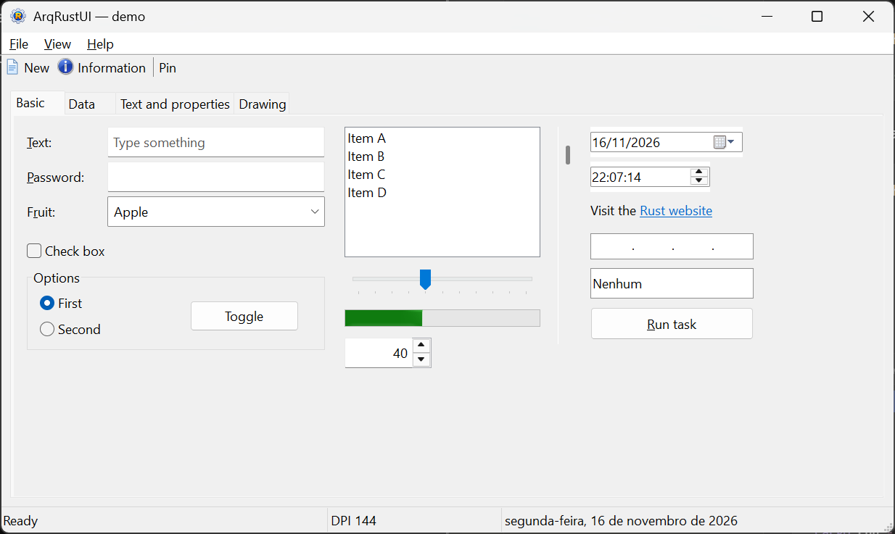

## What the library provides

| Area | Capabilities |
|---|---|
| Windows and application lifecycle | Top-level and owned windows, modal dialogs, shortcuts, per-monitor DPI, focus management and an event loop. |
| Native controls | Buttons, text/password fields, check boxes, radio buttons, combo boxes, lists, trees, tabs, calendars, date/time pickers, sliders and progress bars. |
| Data presentation | Multicolumn `ListView`, virtualized/editable `DataGrid`, filtering, grouping, cell styles, CSV/HTML export and typed `PropertyGrid` values. |
| Modern controls | `ToggleSwitch`, `NumberBox` with simple arithmetic expressions, `RatingControl`, `Card`, `Expander` and `BreadcrumbBar`. |
| Application structure | `DockHost`/`DockPane`, detachable tabs, split containers, scrollable content and a custom `TitleBar`. |
| Commands and navigation | Native `MenuBar` and themed `MenuStrip`, context menus, toolbars, status bars and `CommandBar` with search, split buttons, overflow and customization. |
| Layout | Stack, grid, flow, dock, anchor, absolute and split layouts, plus `StatusBarLayout` and `ScrollViewport`. |
| Drawing | GDI `Canvas`, GDI+ antialiasing and images, Direct2D/DirectWrite, vector paths, gradients and an SVG subset. |
| Charts and animation | Line, area, grouped/stacked bar and pie charts, animated data transitions, easing curves and control/window transitions. |
| Rich text | `RichTextBox`, RTF, styled text runs, lists, tables, images and visual highlighting without replacing the document. |
| System integration | Clipboard formats and monitoring, drag and drop, shell integration, tray icons, Windows notifications, printing and print preview. |
| Accessibility and language | UI Automation models, keyboard navigation, accessible names, IME composition/candidates, touch gestures, regional formatting and translation catalogs. |
| Appearance and icons | Light/dark/high-contrast themes, version-dependent DWM effects and 392 bundled icons in 22 categories, including 58 social-network icons. |

The implementation uses native Windows controls where available and composes or draws additional controls with Windows APIs. No GUI framework, web view, JavaScript runtime or third-party Win32 binding crate is required. The optional icon data is supplied by nine first-party crates in this repository.

Feature availability and validation vary by Windows version and environment. See [Compatibility](docs/COMPATIBILITY.en.md) and the [Feature matrix](docs/FEATURE_MATRIX.en.md) for the supported scope of each subsystem.

## Screenshots

These captures show the library's examples and a separate application using its public API. Some supplied images contain Portuguese text or show earlier demo revisions; library text can be selected in Portuguese or English, and native Windows text follows the operating system.

### Command bar

Icon and text commands, menu and split buttons, search and automatic overflow. Run `cargo run --offline --release --example command_bar`.

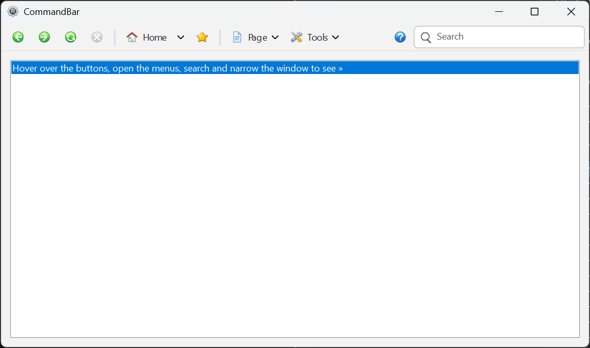

### Data controls

A tree and a multicolumn list in the general demonstration. Run `cargo run --offline --release --example demo` and select the Data tab.

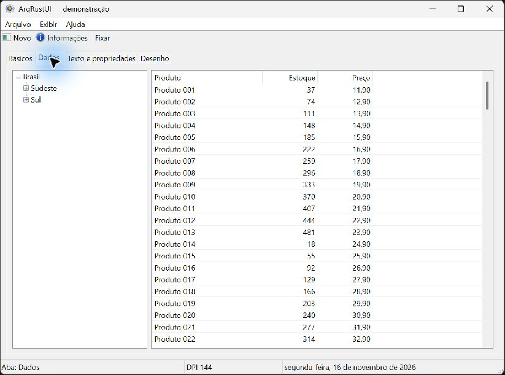

### Charts, SVG and animation

The chart example supports line, area, grouped/stacked bar and pie views with transitions and point interaction. Run `cargo run --offline --release --example charts`.

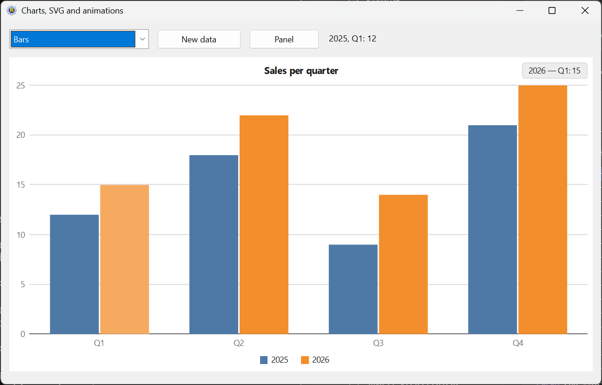

### Custom drawing

Shapes, text, gradients, transparency, paths and an interactive drawing surface. Run `cargo run --offline --release --example custom_drawing`.

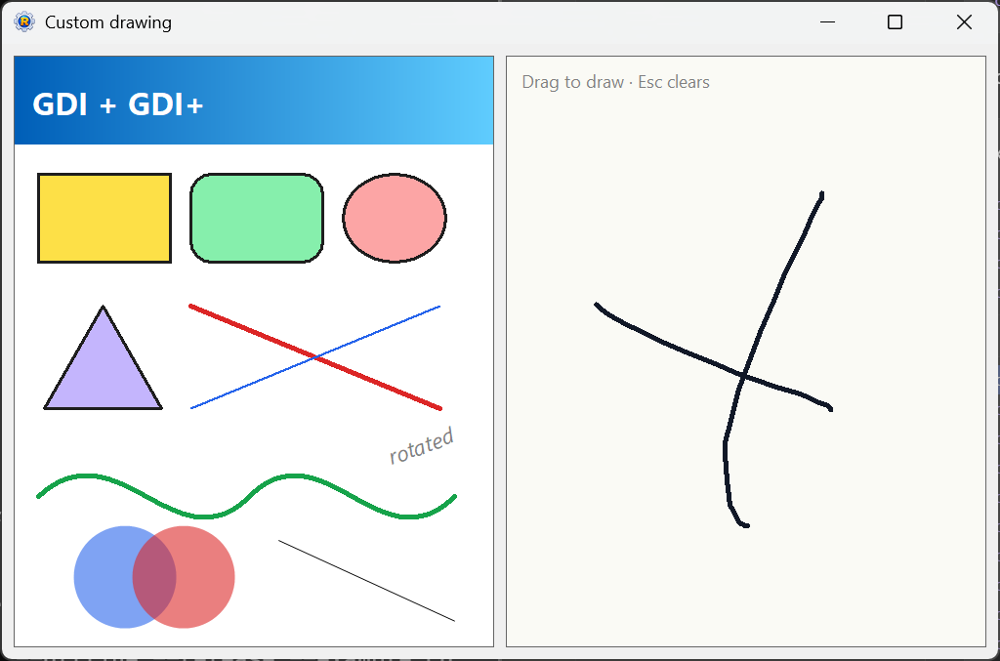

### Icon browser

Browse categories, inspect sizes and aliases, preview assets and export available ICO, PNG and SVG sources. Run `cargo run --offline --release --example icons`.

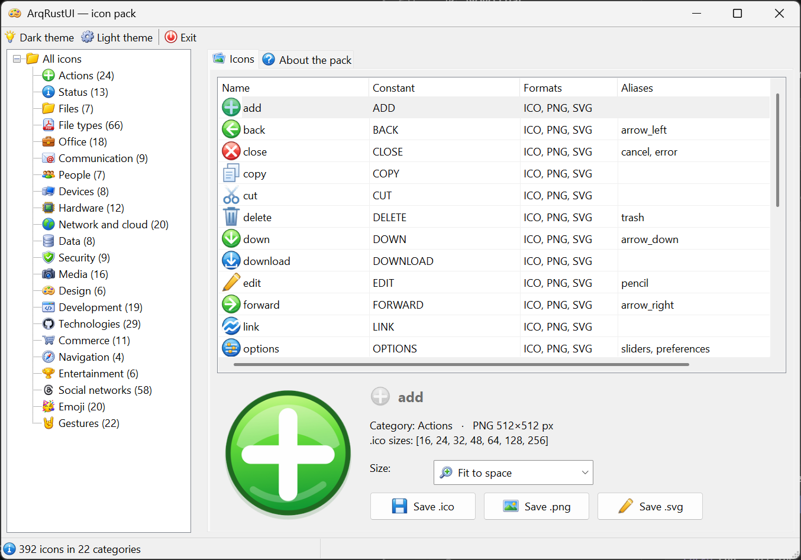

### Modern controls and dockable panes

A custom title bar, dockable panes, detachable tabs, a breadcrumb trail, a toggle switch, a number box, star rating and cards. This capture follows the DPI scaling correction. Run `cargo run --offline --release --example modern_controls`.

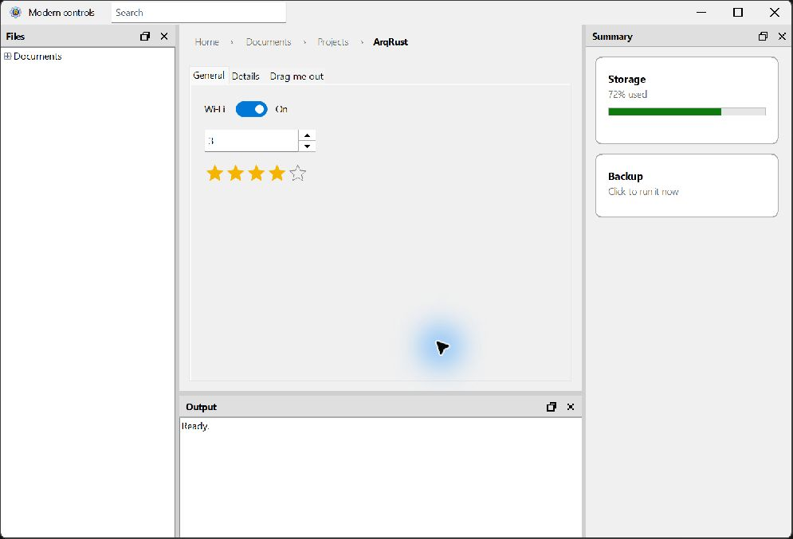

### Application showcase: PocketTools

PocketTools is the ArqRust suite's pilot application. Its home screen illustrates composition of the library's controls and icons. **Its source code is maintained separately under `ArqRustApps/PocketTools`; it is not included in this library repository and is not a library dependency.**

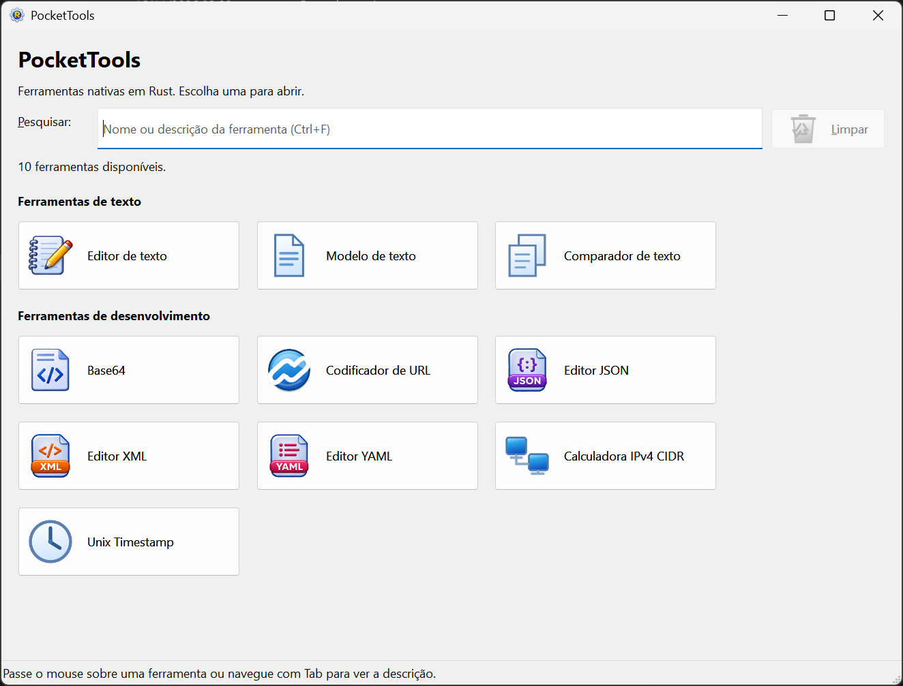

<details>
<summary>Additional supplied captures: localized demos and earlier revisions</summary>

These images are retained as supplied, alongside the primary captures above.

**Portuguese general demonstration:**

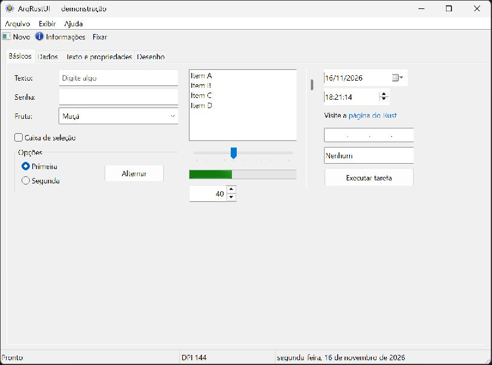

**Earlier modern-controls capture:** this image predates the DPI fix and shows clipped switch/rating graphics. It is historical; the later capture above shows the corrected rendering.

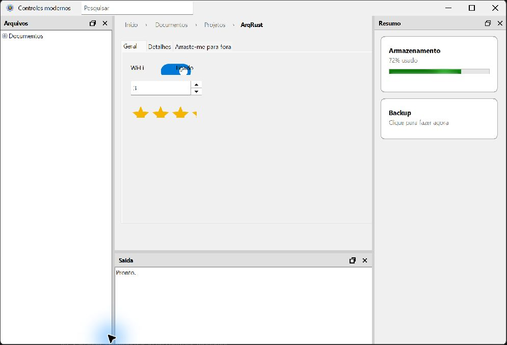

**Alternative PocketTools capture:**

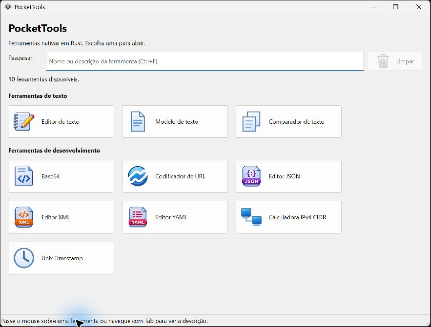

</details>

## Getting started

### Requirements

| Requirement | Details |
|---|---|
| Operating system | Windows 10 or Windows 11. The library is gated with `cfg(windows)`; an empty build on another OS does not validate GUI functionality. |
| Rust | Edition 2021; the manifests declare Rust 1.80 as the minimum supported version. |
| Native toolchain | A Windows Rust toolchain and its linker. MSVC builds require the Visual C++ build tools and Windows SDK; GNU builds require a compatible MinGW linker. |
| Architectures | x64 is the primary development target. x86 has historical validation; ARM64 has compile-only status. Consult the compatibility guide before targeting another architecture. |

`Application::new()` initializes visual styles, DPI support and OLE/COM. Ordinary applications do not need their own Win32 initialization or resource script to use the library.

### Add a local dependency

Keep the library checkout beside your application directory:

```text
projects/
├── ArqRustUI/
│   ├── Cargo.toml
│   ├── crates/
│   └── src/
└── MyApplication/
    ├── Cargo.toml
    └── src/main.rs
```

In your application's `Cargo.toml`:

```toml
[dependencies]
arqrustui = { path = "../ArqRustUI" }
```

This local path works without publishing any package. Keep the complete library directory, including `crates/`; copying only `src/` is insufficient. Registry installation can be documented after a release has actually been published to crates.io.

### A complete application

Place this in `src/main.rs` of your application:

```rust
#![windows_subsystem = "windows"]

use arqrustui::prelude::*;

fn main() -> GuiResult<()> {
    let app = Application::new()?;
    arqrustui::i18n::set_library_language("en");

    let window = Window::builder()
        .title("Hello from ArqRustUI")
        .size(560, 260)
        .min_size(400, 220)
        .centered()
        .build()?;

    let name = TextBox::builder()
        .placeholder("Your name")
        .parent(&window)
        .build()?;
    let greet = Button::builder().text("Say hello").parent(&window).build()?;
    let message = Label::builder().text("Enter your name to begin.").parent(&window).build()?;

    let input = name.clone();
    let output = message.clone();
    greet.on_click(move || output.set_text(&format!("Hello, {}!", input.text())));

    let layout = StackLayout::vertical().spacing(12).padding(Thickness::all(20));
    layout.add_with(&name, LayoutParams::new().height(DEFAULT_CONTROL_HEIGHT));
    layout.add_with(
        &greet,
        LayoutParams::new().width(160).height(DEFAULT_CONTROL_HEIGHT).align_h(Align::Start),
    );
    layout.add_with(&message, LayoutParams::new().weight(1.0));
    window.set_layout(layout);

    window.show();
    app.run()
}
```

This uses public APIs, creates the application before its controls, keeps callbacks independent through cloned handles and lets the layout follow resizing.

## Core concepts

- **One UI thread:** visual types are not `Send` or `Sync`. Use the dispatcher, background helpers or async integration to deliver worker results to the UI.
- **Cloneable handles:** cloning a widget does not create another native control. Its lifetime follows the native window, explicit destruction and parent ownership.
- **Logical coordinates:** control sizes and positions use 96-DPI logical units. The library performs monitor scaling; applications should not multiply those values by DPI.
- **Explicit results:** fallible operations return `GuiResult<T>`. A canceled native dialog commonly returns `Ok(None)`; missing platform features return `GuiError::Unsupported`.
- **Reusable layouts:** use layout managers for resizable content. Fixed coordinates remain available when needed.
- **Theme and language selection:** applications choose themes and user-facing text. Library-owned labels use the `LibraryText` tables; the public API and rustdoc are in English.

See the [extended English guide](README.en.md) for event naming, threading, components and more examples.

## Icons and window branding

The `icons` feature is **enabled by default**. The catalog contains 392 icons, including 66 file-type icons and 58 social-network icons. Use constants such as `icons::SAVE` and `icons::FOLDER` when the icon is known at compile time. `icons::for_extension` and `icons::for_path` resolve file-type icons; name/alias lookup and catalog iteration are also available.

ICO sources provide several sizes for DPI-aware controls, PNG sources support larger previews, and 79 assets also provide SVG source. SVG rendering implements a documented subset; exportable SVG source does not imply every SVG element is rendered. See [icon provenance](assets/icons/README.md) and [social icon credits](docs/ICON_LICENSES.md).

The bytes are split across eight data crates and one facade. With release LTO, unused icon constants can be eliminated. Referencing the whole catalog through `all`, `find` or `in_category` retains it. Debug builds may be substantially larger.

To omit the optional catalog:

```toml
[dependencies]
arqrustui = { path = "../ArqRustUI", default-features = false }
```

`IconAsset` and `IconSource` remain available for application-owned assets. Windows without an explicit icon use `icons::DEFAULT_WINDOW_ICON`, even without the optional catalog. Override it with `WindowBuilder::icon` or `Window::set_icon`.

The icon embedded in an application's **executable file** is a separate build-time responsibility of that application.

## Examples

Run these commands from the directory containing this repository's `Cargo.toml`:

```powershell
cargo run --offline --release --example demo
cargo run --offline --release --example icons
cargo run --offline --release --example command_bar
cargo run --offline --release --example modern_controls
```

Compile all 32 examples without opening their windows:

```powershell
cargo build --offline --release --examples
```

Run any example below with `cargo run --offline --release --example NAME`:

| Example | Demonstrates |
|---|---|
| `accessibility` | Accessible names, keyboard navigation and a custom UI Automation control. |
| `button_alignment` | Horizontal alignment of button icon/text groups. |
| `calculator` | A button grid and keyboard-driven calculator. |
| `charts` | Charts, SVG, animated data and a sliding panel. |
| `command_bar` | Commands, menus, split buttons, search and overflow. |
| `composition` | Scrolling, highlighted text and content-fitted status bars. |
| `custom_drawing` | GDI/GDI+ primitives and interactive custom drawing. |
| `dark_theme` | Theme switching and system appearance. |
| `demo` | Basic controls, data, rich text and drawing in one demonstration. |
| `direct2d` | Direct2D/DirectWrite drawing and animation. |
| `drag_drop` | Reordering, external drags and accepting dropped content. |
| `file_dialogs` | Open/save/folder, color/font, task and printing dialogs. |
| `hello_world` | A minimal window and event loop. |
| `icons` | Browsing, previewing and exporting icon assets. |
| `listview_columns` | Multicolumn lists, sorting, selection and images. |
| `login` | An owned login dialog. |
| `menu_strip` | Themed menus, shortcuts, radio/check items and overflow. |
| `menus` | Native menus, context menus and system menu integration. |
| `modal` | Dimmed-backdrop dialogs, validation and focus management. |
| `modern_controls` | Custom title bar, docking, detachable tabs and modern controls. |
| `multiple_buttons` | Default/cancel buttons, Enter and Esc. |
| `multiple_windows` | Owned, frameless, translucent and fullscreen windows. |
| `notifications` | Info bars, in-window toasts and Windows notifications. |
| `responsive_layout` | Resizable dock, grid and flow layouts. |
| `rich_highlight` | Visual text highlighting independent of a parser. |
| `styled_text` | Styled text, RTF lists/tables/images and IME candidate UI. |
| `tabs` | Separate content and layouts in tabs. |
| `text_editor` | Text editing, files, search and status information. |
| `text_form` | A form arranged with a grid. |
| `tray` | Tray icon, context menu and notifications. |
| `treeview` | A tree with a resizable details panel. |
| `validated_form` | Field validation in a complete form. |

## Documentation

| Document | Purpose |
|---|---|
| [Library guide](BIBLIOTECA.en.md) | Scope, features, usage, dependencies and limitations. |
| [Extended English guide](README.en.md) | Concepts, events, component map and examples. |
| [Components](docs/COMPONENTS.en.md) | Components and API guidance. |
| [Architecture](docs/ARCHITECTURE.en.md) | Internal modules and design. |
| [Events](docs/EVENTS.en.md) | Events, naming, threading and async work. |
| [Memory and safety](docs/MEMORY_AND_SAFETY.en.md) | Handle ownership, RAII and FFI boundaries. |
| [Custom controls](docs/CUSTOM_CONTROLS.en.md) | Building reusable controls. |
| [Compatibility](docs/COMPATIBILITY.en.md) | Windows versions and environment-dependent behavior. |
| [Feature matrix](docs/FEATURE_MATRIX.en.md) | Implementation and validation status. |
| [Changelog](CHANGELOG.en.md) | Changes and migration notes. |
| [Release guide](docs/RELEASING.en.md) | GitHub preparation and the ten related crates. |
| [Contributor/agent guide](AGENTS.en.md) | Repository rules and patterns. |

Generate the English API reference locally:

```powershell
cargo doc --offline --workspace --no-deps --open
```

The manifest configures the Windows target needed for future docs.rs builds. Portuguese versions of the main guides are retained alongside their English versions.

## Project status

ArqRustUI is a **development-stage 0.1.0 library**. Publishing the source repository does not mean all Windows integrations have completed validation or that a crates.io release has been made. APIs can change before 1.0.

The latest recorded complete local Windows run, on **2026-11-16**, had **356 passing tests, 32 failures and one excluded printing-dialog test** that had previously hung. The failures matched the earlier baseline; 60 doctests and five GDI tests passed. See the [validation record](docs/CORRECOES_DEMOS_E_RUSTDOC.md) and [feature matrix](docs/FEATURE_MATRIX.en.md). These are dated results, not a claim that every test currently passes.

System notifications, touch hardware, IME, accessibility clients, printing, DWM effects and other integrations have environment-specific requirements and incomplete validation. ARM64 has compile-only status. SVG is a subset, not a browser-equivalent renderer.

### Development checks

On Windows, with the complete checkout:

```powershell
cargo fmt --all --check
cargo clippy --offline --workspace --all-targets -- -D warnings
cargo test --offline --doc
cargo build --offline --release --examples
cargo metadata --offline --format-version 1
```

GUI tests create real windows and can interact with focus, clipboard, printing and system services. Use a suitable desktop session. To reproduce the earlier run while excluding the known blocking print-dialog test:

```powershell
cargo test --offline --no-fail-fast -- --test-threads=1 --skip print_and_page_setup_dialogs_cancel_cleanly
```

The [CI workflow](.github/workflows/ci.yml) defines formatting, lint, documentation, Windows targets, minimum-Rust and package-size checks. Its presence does not imply that a GitHub Actions run has already succeeded.

## Repository and future publication

**Use the complete `ArqRustUI` directory as the root of its GitHub repository.** It is independently buildable and contains all nine first-party icon subcrates. The parent ArqRust suite and the PocketTools application are separate projects.

```text
ArqRustUI/                 repository root
├── Cargo.toml             main package and local workspace
├── Cargo.lock
├── README.md
├── LICENSE
├── .github/workflows/
├── assets/                branding, provenance and previews
├── crates/                icon facade and eight data packages
├── docs/                  guides and local screenshots
├── examples/              32 independent examples
├── src/                   library implementation
└── tests/                 integration tests
```

Keep the hidden Git configuration files and `.github/` when preparing the checkout. The existing Git history belongs to this library. Build caches, editor caches, local archives and compiled output are excluded by `.gitignore`; they are not required in the source repository. Screenshots use relative paths and are stored here, so the README does not depend on a local website checkout.

For a future crates.io release, this repository contains **ten packages**: eight icon-data crates, `arqrustui-icons`, then `arqrustui`. They share version 0.1.0 and must be released in dependency order. The main crate uses this English README. The [release guide](docs/RELEASING.en.md) describes metadata, package checks, licensing and publication. GitHub upload and crates.io publication are separate actions; neither is performed by preparing these files.

## Contributing

Read [AGENTS.en.md](AGENTS.en.md) and the architecture/compatibility guides before changes. Keep features generic, use public APIs from applications, preserve thread affinity and handle ownership, document unsafe contracts and add focused regression tests for behavior changes.

The implementation uses only Rust, `std`, native Windows APIs and the suite's own local code. Do not introduce third-party Rust dependencies, generated binding crates or application-specific business logic. Keep English rustdoc and paired English/Portuguese guides consistent.

## License and asset credits

The library's Rust code is licensed under **MIT**; see [LICENSE](LICENSE).

Artwork has its own provenance and attribution requirements. The bevel social-icon set includes artwork based on Font Awesome Free under **CC BY 4.0**; affected data packages declare `MIT AND CC-BY-4.0` and include notices. See [icon credits](docs/ICON_LICENSES.md), [social asset provenance](assets/icons/social/ORIGEM.md) and the [received license text](assets/icons/social/FONT_AWESOME_LICENSE.txt). Brand names and logos remain the property of their respective owners.
