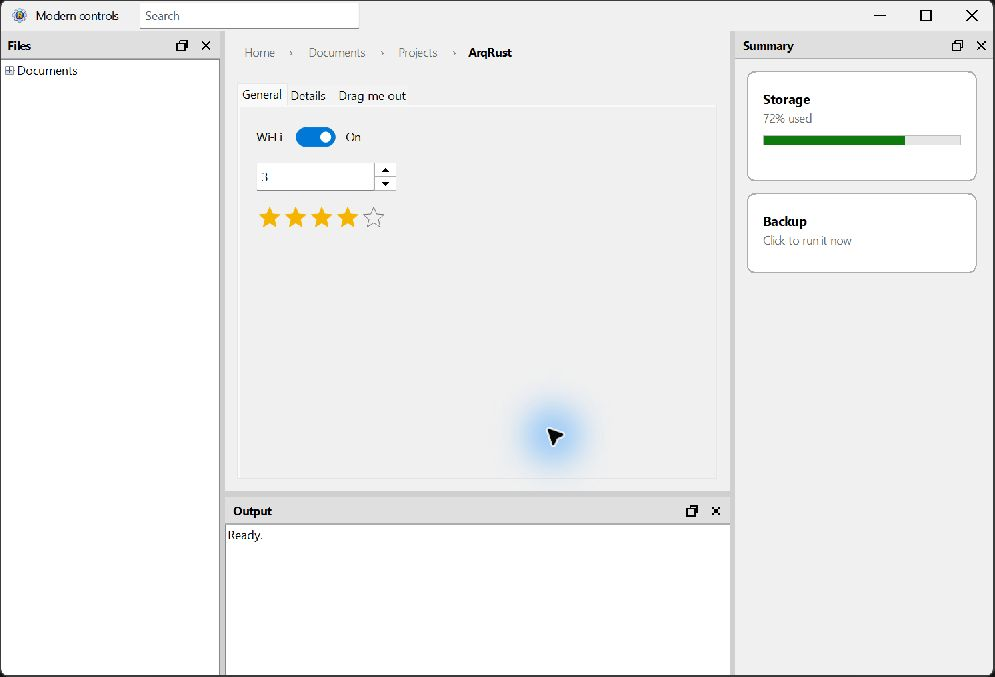
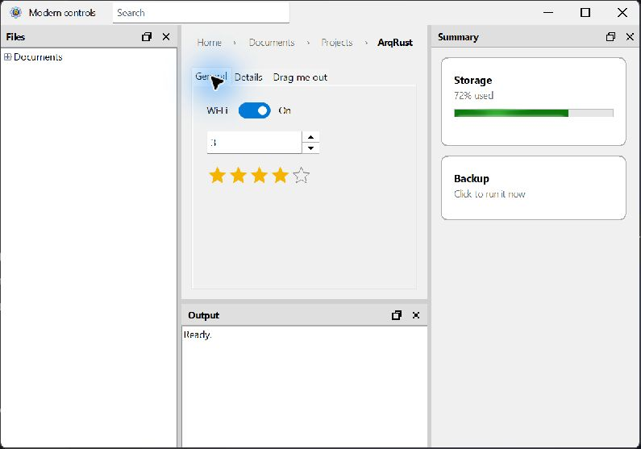

# Correções das demos e documentação Rust — 16/11/2026

## Erro do anexo

O comando `cargo clippy --workspace --all-targets -- -D warnings` falhava com
`clippy::map_or_identity` em `src/input/drag/reorder.rs`. A imagem de arraste
agora usa `snapshot(hwnd, rect).unwrap_or(std::ptr::null_mut())`, preservando o
mesmo resultado e removendo a operação redundante. O comando rigoroso passou.

Os avisos de hard link do cache incremental são diferentes desse erro.
As compilações de validação deste trabalho usaram `CARGO_INCREMENTAL=0`.

## Documentação em inglês

O rustdoc dos 166 arquivos Rust em `src/` e `crates/` foi revisado e traduzido:
módulos, tipos, métodos, variantes, campos, contratos `Safety`, documentação
compartilhada de builders, crates de dados e catálogo de ícones. A macro `icon!`
também gera descrições em inglês. Os exemplos publicados e seus comentários
acompanham o idioma da documentação.

Textos em exemplos de internacionalização, nomes de localidades e aliases
históricos mantêm seus valores quando eles são o objeto do exemplo ou parte
da compatibilidade da API. Tabelas de tradução e textos de execução não foram
alterados pela tradução do rustdoc. Comentários internos comuns não publicados
pelo rustdoc não são o escopo dessa padronização.

As alterações da outra IA em erros, exemplos e guias foram preservadas. A
comparação com a cópia dos fontes anterior à tradução confirmou que os únicos
arquivos com diferenças fora de linhas rustdoc nessa etapa são `gdi.rs`
(comentários e testes da correção de desenho) e `catalog.rs` (macro de documentação).
Não foram adicionadas dependências. As dez crates verificadas são locais e próprias.

## Demos

- O comando **New** em `demo` e `menus` usa o ícone de documento `icons::FILE`.
  Os exemplos continuam compilando sem o catálogo opcional.
- `Canvas::with_gdiplus` salva o estado do DC, retira temporariamente a escala
  de mapeamento herdada e aplica a escala do GDI+ uma única vez. O estado é
  restaurado inclusive em caso de erro ou pânico. Isso corrige o interruptor e
  as estrelas cortados em telas com escala de 150%.
- Dois testes de pixels cobrem 96, 144 e 192 DPI, o desenho GDI antes/depois do
  GDI+, a transformação e o recorte. A reprodução de escala falhou antes da
  correção e passou depois.
- A demo `modern_controls` usa layouts para a trilha, abas e controles da aba
  General, com limite mínimo de 780×520. O campo numérico preserva a largura de
  140 unidades; o expansor acompanha a largura da aba Details.

## Conferência visual

Capturas em Windows real, com DPI informado pela demo de 144 (150%).
Foram conferidos interruptor, cinco estrelas, campo numérico, abas, margens e
painéis. Também foi aberta a aba Details e expandido seu conteúdo.

Tamanho padrão, área cliente solicitada de 980×640:

Tamanho mínimo, área cliente solicitada de 780×520:

A captura mínima foi feita com uma compilação de conferência que muda somente
o tamanho inicial para 780×520, em `target/qa-minimum`. O fonte foi restaurado
para 980×640 após a compilação. As imagens têm 995×677 e 795×557 pixels,
respectivamente, incluindo a geometria externa resultante da barra personalizada.

Outras capturas: [Details expandido](screenshots/modern-controls-minimum-details.jpg)
e [ícone New](screenshots/demo-new-icon.jpg).

## Validação

Comandos executados na biblioteca, com `--offline` onde aplicável:

| Verificação | Resultado |
|---|---|
| `cargo fmt --all --check` | Aprovado |
| `cargo clippy --workspace --all-targets -- -D warnings` | Aprovado, sem avisos |
| `cargo doc --workspace --no-deps`, `RUSTDOCFLAGS=-D warnings` | Aprovado nas dez crates |
| `cargo test --doc` | 60 passaram |
| Testes de `graphics::gdi::tests` | 5 passaram |
| `cargo build --release --examples` | Aprovado |
| `cargo check --no-default-features --example demo --example menus --example modern_controls` | Aprovado |
| `cargo metadata --format-version 1` | Dez pacotes locais; nenhum pacote externo |
| Suíte completa com `--no-fail-fast -- --test-threads=1 --skip print_and_page_setup_dialogs_cancel_cleanly` | 356 passaram, 32 falharam, um excluído |

As 32 falhas coincidem exatamente, por nome, com o registro anterior em
`target/bevel-import/test-final.log`. São falhas já presentes em testes nativos
de desenho, eventos e integração; este trabalho não declara a suíte completa
aprovada. O diálogo de impressão excluído já havia travado na execução anterior.

Os logs desta etapa estão em `target/doc-english/`. Houve uma tentativa de
recompilação com a demo aberta que falhou por bloqueio do executável
(`LNK1104`); a compilação foi repetida depois de fechar as janelas de conferência.

O PocketTools também foi recompilado em release com a biblioteca atualizada.
Seus testes passaram, incluindo a conferência do ícone embutido no executável.
As alterações descritas aqui pertencem à biblioteca e às suas demos; nenhuma
regra específica do aplicativo foi introduzida na ArqRustUI. Nenhum commit foi feito.
